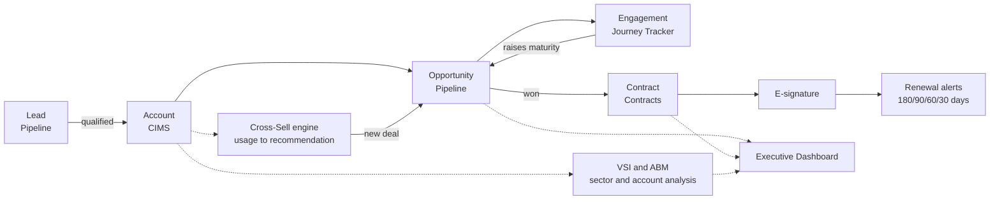
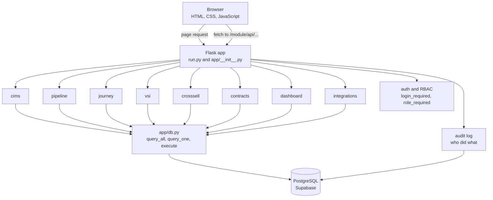
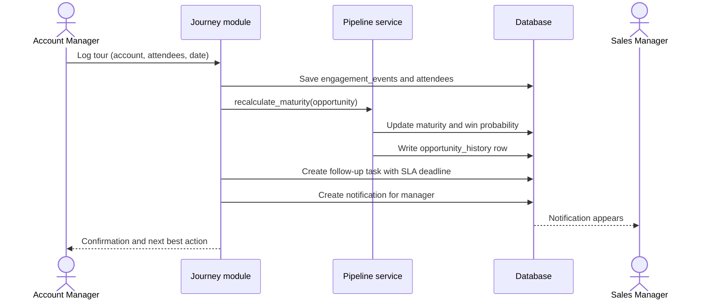
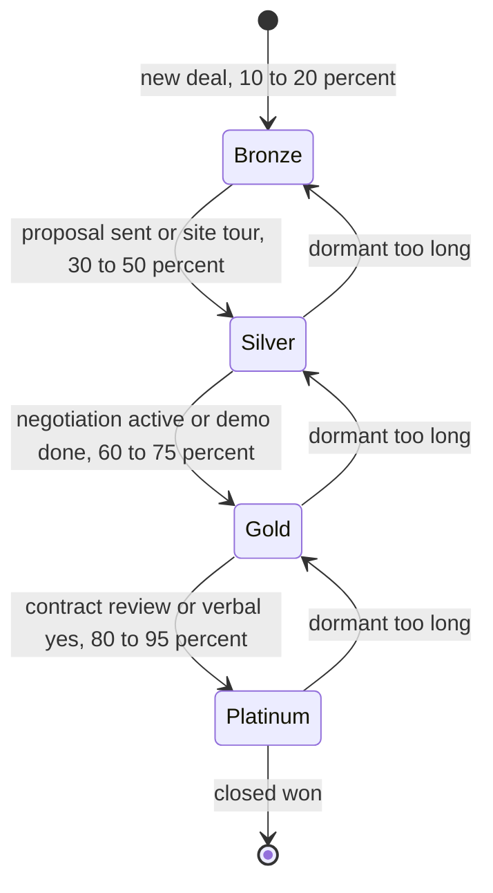
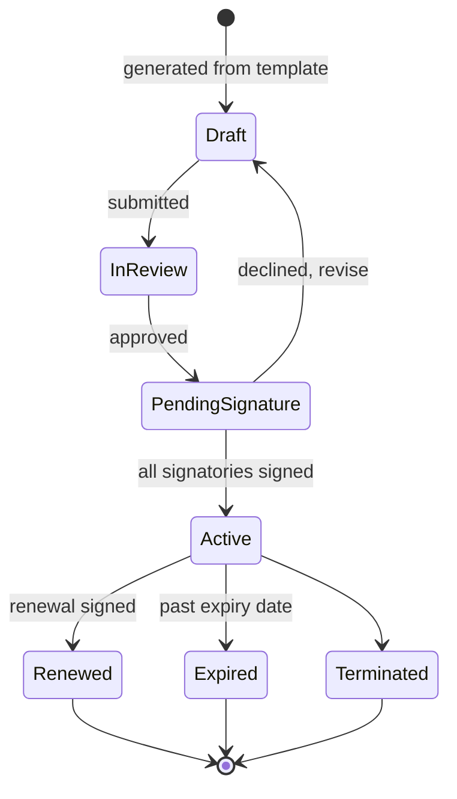
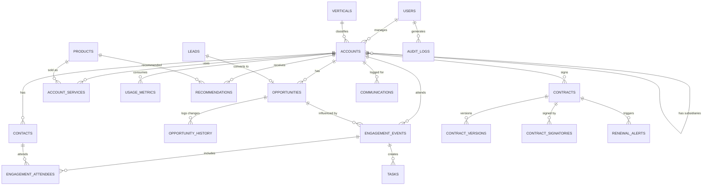
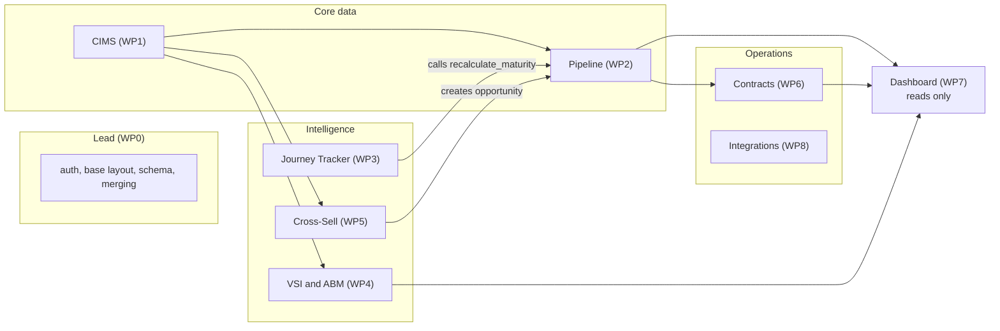

# How Nexus 360 Works (read this first)

## The one-sentence version
Nexus 360 is a website where Infratel's sales team keeps **everything about their business customers in one place**: who they are, what deals we are chasing, what they have visited or attended, what products they use, and what contracts they have signed.

Today that information is scattered across spreadsheets and emails. Nexus 360 replaces that with one shared system.

---

## The story of one customer (the business workflow)

Follow one company, "Acme Mining", through the system. Each step is a module a teammate builds.

```
 LEAD  -->  ACCOUNT  -->  OPPORTUNITY  -->  ENGAGEMENT  -->  CONTRACT  -->  RENEWAL
(Pipeline)  (CIMS)       (Pipeline)       (Journey Tracker)  (Contracts)    (Contracts)
                              |                                    |
                       VSI & ABM (analysis)              Cross-Sell (grow the account)
                              \________________  Dashboard  ______________/
```

1. **Lead (Pipeline module).** Acme fills in a web form or meets us at an event. We store them as a *lead*: someone who might buy. Leads are kept separate from real deals so the pipeline stays clean.
2. **Account (CIMS).** Once Acme is qualified, the lead becomes an **account**: the company record. We add its **contacts** (the CFO, the IT director, the champion who likes us). Everything about Acme will hang off this record, so it is called the *Single Customer View*.
3. **Opportunity (Pipeline).** We create a deal: "Acme: Colocation, $200k". It has a stage (qualification, proposal, negotiation...) and a **maturity grade**:
   - Bronze: just talking (10-20% chance)
   - Silver: proposal sent, toured the site (30-50%)
   - Gold: negotiating, decision-maker engaged (60-75%)
   - Platinum: contract review, verbal yes (80-95%)

   The **weighted pipeline** is amount x chance. It gives an honest forecast instead of gut feel.
4. **Engagement (Journey Tracker).** Acme's CTO visits our data centre. We log the tour. The system then **automatically** raises the deal's maturity, creates a follow-up task for the account manager with a deadline, and notifies the sales manager. This is our unique feature: experiences move deals forward.
5. **VSI and ABM (analysis).** *VSI* groups all accounts by industry (Mining, Banking, Telecom...) and ranks which sectors earn the most. *ABM* maps each big customer: who is on the buying committee (economic buyer, champion, blocker), and which departments of that company are not yet our clients (white space).
6. **Cross-Sell (Cross-Sell Engine).** Acme uses 85% of its rack space and has no disaster-recovery plan. The engine flags: "Recommend DRaaS, 78% likely to adopt." It also shows *why* (the signals), and a rep can turn it into a new opportunity.
7. **Contract (Contracts).** The deal closes. The system generates a contract from a template using Acme's details, stores the PDF, and sends it for **e-signature**.
8. **Renewal (Contracts).** At 180, 90, 60 and 30 days before expiry, the system alerts the account manager, so no renewal is missed.
9. **Dashboard.** Executives see totals: pipeline value, forecast, deals by maturity, renewals due, at-risk accounts.

Behind all of it: **login with roles** (a sales rep sees less than a manager) and an **audit log** that records who viewed or changed what.

---

## The technical picture (how the code works)

```
  Browser (HTML + CSS + JS)
        |   page request / fetch("/cims/api/accounts")
        v
  Flask app  (run.py -> app/__init__.py)
        |   routes to the right module (blueprint)
        v
  app/modules/<module>/routes.py   <- your code: gets request, runs SQL, returns page or JSON
        |   query_all / query_one / execute  (app/db.py)
        v
  PostgreSQL on Supabase   (tables defined in db/schema.sql)
```

- **Flask** is the web server. A *route* is a Python function that runs when someone opens a URL.
- Each **module is a Blueprint**: a mini-app with its own URLs (`/cims`, `/pipeline`, `/contracts`...). That is why 8 people can work at the same time without touching each other's files.
- **Two kinds of routes:**
  - *Page routes* return an HTML page (Jinja template in `app/templates/<module>/`).
  - *API routes* (`/<module>/api/...`) return JSON. JavaScript on the page calls them with the `api()` helper to load data, draw charts, or save forms without reloading.
- **Database:** tables are in `db/schema.sql`. The most important ones: `accounts`, `contacts`, `opportunities`, `engagement_events`, `contracts`, `recommendations`, `audit_logs`. Tables link by IDs (an opportunity has an `account_id`).
- **Security:** `@login_required` / `@role_required(...)` on routes, and `audit(...)` whenever data is created, changed or viewed.

### Where do I put my code?
| I want to... | Edit |
|---|---|
| Add a page | `app/templates/<module>/page.html` + a route in `routes.py` |
| Add a data endpoint | a `/api/...` route in my `routes.py` |
| Read/write the database | `query_all`, `query_one`, `execute` from `app.db` |
| Add page-specific JS/CSS | `app/static/js/<module>.js`, `app/static/css/<module>.css` |
| Need a new table/column | new file in `db/migrations/`, tell the lead |

### Mini example (a complete new endpoint)
```python
@bp.route("/api/opportunities")
@login_required
def api_opps():
    rows = query_all("SELECT id, name, amount, maturity FROM opportunities ORDER BY amount DESC")
    return api_ok(rows)
```
```html
<script>
  api('/pipeline/api/opportunities').then(rows => console.log(rows));
</script>
```

---

## Diagrams
These render automatically on GitHub. (In VS Code, install the "Markdown Preview Mermaid Support" extension.)

PNG copies of every diagram (for slides and the pitch deck) are in docs/diagrams/.

### 1. The customer journey (business workflow)


### 2. System architecture (how the code fits together)


### 3. What happens when a data-centre tour is logged


### 4. Opportunity maturity levels


### 5. Contract and e-signature lifecycle


### 6. Database map (main tables)


### 7. Who owns what (module map)


---

## Glossary
- **CIMS**: Customer Information Management System: the central customer database
- **SCV**: Single Customer View: one page showing everything about a customer
- **Pipeline**: all open deals, and what they might be worth
- **Weighted pipeline**: deal amount x chance of winning
- **VSI**: Vertical Sales Indexing: ranking industries by revenue and growth
- **ABM**: Account-Based Marketing: tailoring effort to specific big customers
- **Buying committee**: the people who jointly decide a purchase
- **White space**: parts of a customer we don't yet serve
- **Cross-sell / upsell**: selling a different or bigger product to an existing customer
- **eSPF / ERP**: Infratel's internal systems we must be able to connect to
- **RBAC**: role-based access control
