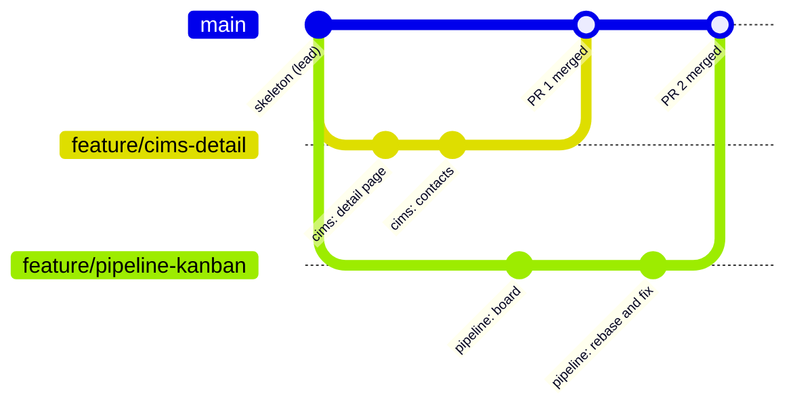
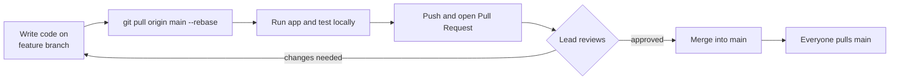
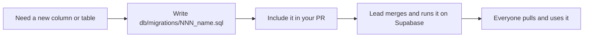

# Team Workflow

## The cycle for every task
```
 pull main -> code + test locally -> commit -> pull again -> push main
```

### Step by step
```bash
# 1. Always pull first — get everyone else's latest changes
git pull origin main

# 2. Work. Run the app often to check nothing is broken:
python run.py

# 3. Commit small and often (stay in your module folder)
git add app/modules/pipeline app/templates/pipeline
git commit -m "pipeline: add kanban board page"

# 4. Pull again before pushing (someone else may have pushed while you worked)
git pull origin main

# 5. Push straight to main
git push origin main
```

### Git flow diagram


### Pull Request review flow


### Database change flow


## Rules
1. **Everyone pushes directly to `main`** (no PRs for now — we are all testing locally first).
   Test your pages locally before every push. If you break `main`, fix it immediately.
2. **Pull before you push — every single time.**
   ```bash
   git pull origin main
   # ... your work ...
   git push origin main
   ```
3. **Stay in your lane:** edit only your module's folder and templates.
   Shared files (`base.html`, `main.css`, `db.py`, `schema.sql`) belong to Person 1 only.
4. **Never commit secrets.** `.env` is git-ignored. DB URLs and keys go in `.env` only.
5. **Never commit `nexus360_local.sqlite3`** — it's git-ignored and each person keeps their own.
6. **Need a new table or column?** Tell Person 1. They add a migration and update the SQLite schema.
7. **App must start before you push.** Run `python run.py` and confirm your pages load.
8. **Ask early.** Blocked for more than 20 minutes? Message the group.
9. **Commit messages:** `module: what you did` (e.g. `contracts: add renewal dashboard`).

## Pull Request checklist (also in `.github/pull_request_template.md`)
- Branch is up to date with `main`
- App runs, my pages load with seed data
- Routes protected with `@login_required` / `@role_required`
- Create/update/delete actions call `audit(...)`
- SQL uses `%s` parameters, no string-built queries
- No `.env`, passwords or keys committed

## Suggested hackathon timeline
| Phase | Goal |
|---|---|
| **Hour 0-1** | Everyone clones, installs, runs the app, logs in. Lead shares DB URL. |
| **Phase 1** | Each module: basic list page + create form working against the DB. |
| **Phase 2** | Core logic: maturity scoring, journey trigger, recommendation rules, renewal alerts, e-sign flow. |
| **Phase 3** | Dashboard charts and cross-module links (e.g. account page shows its opps and contracts). |
| **Final stretch** | Feature freeze. Polish UI, fix bugs, load realistic demo data, rehearse the demo. |

## Demo script (aim ~5 minutes)
1. Dashboard overview: pipeline, forecast, renewals due
2. Customer Single View for one big account
3. Log a data-centre tour -> watch maturity jump + task created
4. VSI heatmap + buying committee graph
5. Cross-sell recommendation with the "why" signals -> convert to opportunity
6. Generate a contract -> e-sign -> renewal dashboard
7. Show audit log and role-based access (log in as a rep vs manager)

## Integration points to agree on early
- `pipeline/service.py: recalculate_maturity(opportunity_id)` (Pipeline owner writes, Journey owner calls)
- `journey` trigger creates a row in `tasks` and `notifications` (Journey owner)
- Cross-sell "convert" inserts into `opportunities` (Cross-Sell owner, follow the schema)
- Dashboard only **reads** from tables/views; it never imports other modules' code
