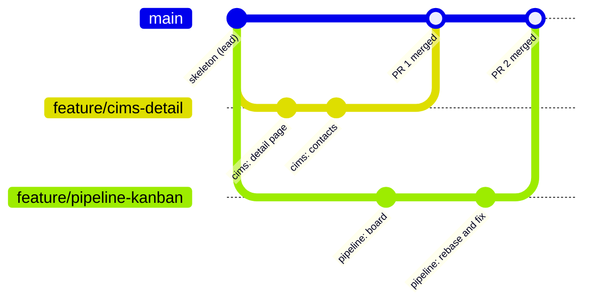
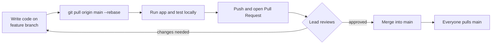
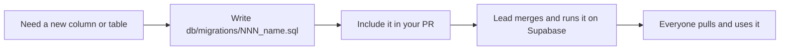

# Team Workflow

## The cycle for every task
```
 pick task (TASKS.md) -> update main -> new branch -> code + test locally -> commit
   -> push -> Pull Request -> review -> merge -> pull main again
```

### Step by step
```bash
# 1. Start from fresh main
git checkout main
git pull origin main

# 2. Create your branch (name = feature/<module>-<what>)
git checkout -b feature/pipeline-kanban-board

# 3. Work. Run the app often:  python run.py
# 4. Commit small and often
git add app/modules/pipeline app/templates/pipeline
git commit -m "pipeline: add kanban board page"

# 5. Stay up to date with others
git pull origin main --rebase

# 6. Push and open a Pull Request on GitHub
git push -u origin feature/pipeline-kanban-board
```

### Git flow diagram


### Pull Request review flow


### Database change flow


## Rules
1. **Never push to `main`.** Only the lead merges Pull Requests.
2. **Stay in your lane:** edit only your module's folder and templates. Shared files (`base.html`, `main.css`, `db.py`, `schema.sql`) belong to the lead.
3. **Need a DB change?** Add `db/migrations/NNN_short_name.sql` (e.g. `002_add_lead_score.sql`), include it in your PR, and tell the lead. The lead applies it to Supabase. Don't edit tables in Supabase by hand.
4. **Don't break main.** Before opening a PR: the app starts (`python run.py`) and your pages load.
5. **Never commit secrets.** `.env` is ignored by git. Keys go in `.env` only.
6. **Ask early.** Blocked for more than 20 minutes? Message the group.
7. **Commit messages:** `module: what you did` (e.g. `contracts: add renewal dashboard`).

## Pull Request checklist (also in `.github/pull_request_template.md`)
- Branch is up to date with `main`
- App runs, my pages load with seed data
- Routes protected with `@login_required` / `@role_required`
- Create/update/delete actions call `audit(...)`
- SQL uses `%s` parameters, no string-built queries
- No `.env`, passwords or keys committed

## Suggested hackathon timeline
| Phase | Goal |
|---|---|
| **Hour 0-1** | Everyone clones, installs, runs the app, logs in. Lead shares DB URL. |
| **Phase 1** | Each module: basic list page + create form working against the DB. |
| **Phase 2** | Core logic: maturity scoring, journey trigger, recommendation rules, renewal alerts, e-sign flow. |
| **Phase 3** | Dashboard charts and cross-module links (e.g. account page shows its opps and contracts). |
| **Final stretch** | Feature freeze. Polish UI, fix bugs, load realistic demo data, rehearse the demo. |

## Demo script (aim ~5 minutes)
1. Dashboard overview: pipeline, forecast, renewals due
2. Customer Single View for one big account
3. Log a data-centre tour -> watch maturity jump + task created
4. VSI heatmap + buying committee graph
5. Cross-sell recommendation with the "why" signals -> convert to opportunity
6. Generate a contract -> e-sign -> renewal dashboard
7. Show audit log and role-based access (log in as a rep vs manager)

## Integration points to agree on early
- `pipeline/service.py: recalculate_maturity(opportunity_id)` (Pipeline owner writes, Journey owner calls)
- `journey` trigger creates a row in `tasks` and `notifications` (Journey owner)
- Cross-sell "convert" inserts into `opportunities` (Cross-Sell owner, follow the schema)
- Dashboard only **reads** from tables/views; it never imports other modules' code
